

  

<h1 align="center">Hey, I'm Dilux 👋</h1>

  <strong>Engineering Technology Student · AI-Native Builder · Founder of Zyberlane</strong> 
  Exploring AI, Robotics, Software Engineering, Automation, Cybersecurity and Immersive Technologies. 
  Building at the intersection of engineering, technology and creativity.

## About me

<picture>
  <source media="(max-width: 600px)" srcset="assets/profile/terminal-mobile.svg">
  
</picture>

<h3 align="center">📚 Languages &amp; Tools I Have Placed My Hands On</h3>

<strong>Languages & Web Foundations</strong>

  
  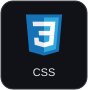
  
  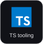
  

<strong>Web Engineering & Build Tools</strong>

  
  
  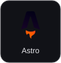
  
  
  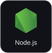
  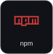
  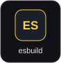

<strong>3D, XR & Motion</strong>

  
  
  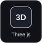
  

<strong>Databases & Backend</strong>

  
  

<strong>Development, Testing & Cybersecurity</strong>

  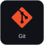
  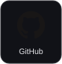
  
  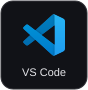
  
  
  

<strong>Cloud & Deployment</strong>

  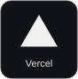
  
  
  

<strong>AI & Assisted Building</strong>

  
  
  
  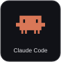
  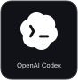
  

<strong>Design & Digital Growth</strong>

  
  
  
  

## GitHub analytics

<picture>
  <source media="(max-width: 600px)" srcset="assets/analytics/activity-mobile.svg">
  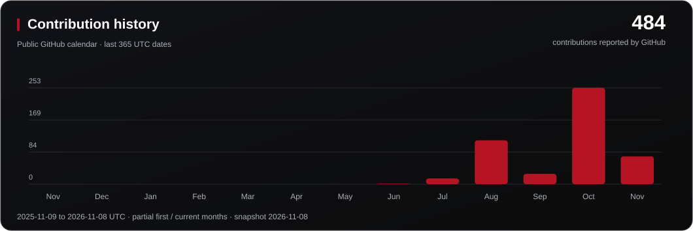
</picture>

  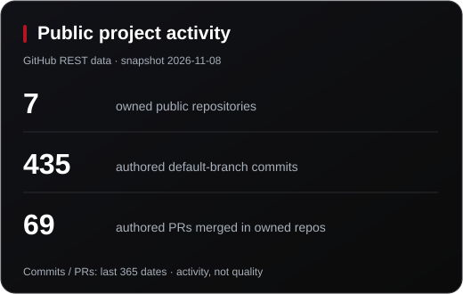

Public GitHub activity, not a measure of programming proficiency. [Methodology](docs/analytics.md) · [Timestamped data](assets/analytics/snapshot.json)

---

<em>Where imagination meets engineering, possibility takes form.</em> — Dilux Lane

