<p align="center">
  
</p>

<h1 align="center">Hey, I'm Dilux 👋</h1>

<p align="center">
  <strong>Student Developer · Founder of <a href="https://zyberlane.com">Zyberlane</a></strong><br>
  Building practical web projects with AI assistance, testing, and iteration.<br>
  Learning toward AI-native systems engineering and automation.
</p>

<p align="center">
  <a href="https://dilux-lane-dev-portfolio.vercel.app">Developer portfolio</a> &nbsp; / &nbsp;
  <a href="https://zyberlane.com">Zyberlane</a> &nbsp; / &nbsp;
  <a href="https://dilux-lane-portfolio.vercel.app">Creative work</a>
</p>

## About me

<picture>
  <source media="(max-width: 600px)" srcset="assets/profile/about-mobile.webp">
  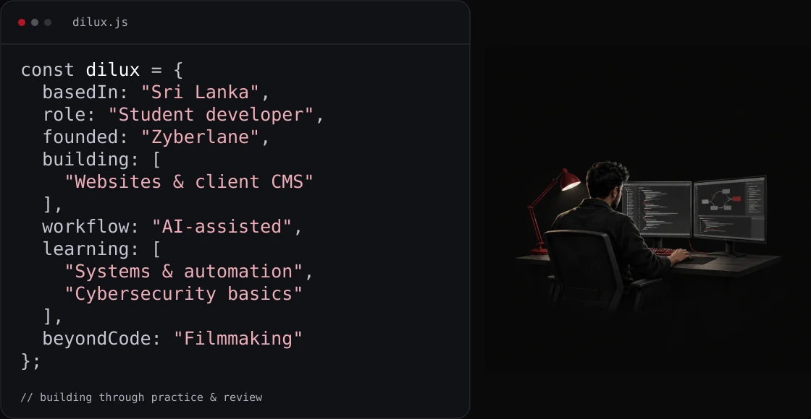
</picture>

<details>
<summary>About me, in plain text</summary>

```javascript
const dilux = {
  basedIn: "Sri Lanka",
  role: "Student developer",
  founded: "Zyberlane",
  building: ["Websites & client CMS"],
  workflow: "AI-assisted",
  learning: ["Systems & automation", "Cybersecurity basics"],
  beyondCode: "Filmmaking"
};
```

</details>

## Languages & tools

<p align="center"><strong>Core web & project-backed tools</strong></p>

<p align="center">
  
  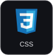
  
  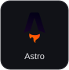
  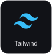
  
</p>

<p align="center"><strong>Build, verification & delivery tooling</strong></p>

<p align="center">
  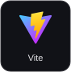
  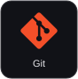
  
  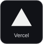
  
  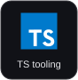
</p>

<p align="center"><sub>Tools used in real projects; no proficiency ranking implied.</sub></p>

## Tech stack

| Area | Current project use |
| :--- | :--- |
| **Frontend** | HTML · CSS · JavaScript · Astro · Tailwind CSS · Vite |
| **Backend & data** | Supabase Auth · Postgres through Supabase · Storage · Row Level Security |
| **Motion & interaction** | GSAP · browser Canvas / WebGL integration and adaptation |
| **Verification** | Playwright · axe-core · browser smoke tests · project-specific regressions |
| **Delivery & workflow** | Git · GitHub · branches & pull requests · Vercel previews |
| **TypeScript** | Tooling and limited project source; continuing to learn |
| **AI-assisted development** | Planning · implementation · review · checks & iteration |

**Learning / exploring:** Python fundamentals, Linux and cybersecurity fundamentals, software systems, and automation. Robotics and industrial automation are longer-term interests.

**How I work:** define the scope → build with AI assistance → run relevant checks → review the PR and preview → release.

## Featured work

| Project | What it represents |
| :--- | :--- |
| **[Divine Tattoo](https://github.com/diluxlane/Divine-Tattoo-Website)** · [Live](https://divinetattoo.vercel.app) | **Client work.** Responsive tattoo portfolio with Supabase-backed publishing, storage, authentication, and gallery management. |
| **[Zyberlane Website](https://github.com/diluxlane/Zyberlane-Website)** · [Live](https://zyberlane.com) | **Owned project.** My founder-led brand's website: services, selected work, inquiry flows, and search-readiness checks. |
| **[Developer Portfolio](https://github.com/diluxlane/Dilux-Lane-Dev-Portfolio)** · [Live](https://dilux-lane-dev-portfolio.vercel.app) | **Personal project.** Vite / GSAP portfolio with project case studies and WebGL interactions. Design adapted with permission; [original credits](https://github.com/diluxlane/Dilux-Lane-Dev-Portfolio/blob/main/THIRD_PARTY_NOTICES.md). |
| **[Video Portfolio](https://github.com/diluxlane/Dilux-Lane-Portfolio)** · [Live](https://dilux-lane-portfolio.vercel.app) | **Personal creative work.** Astro portfolio for editing, videography, and visual storytelling, rebuilt using a permitted design reference. |

**Reference / study tooling:** [Zyberlane Design Reference Library](https://github.com/diluxlane/Zyberlane-Design-Library) organizes authorized references and centralized previews. Referenced designs belong to their credited creators; they are separate from my original work and client delivery.

## GitHub analytics

Repository-hosted snapshots from public GitHub data, refreshed daily after merge. Each card states its scope; [methodology & exact data](docs/analytics.md) explain the limits.

<picture>
  <source media="(max-width: 600px)" srcset="assets/analytics/activity-mobile.svg">
  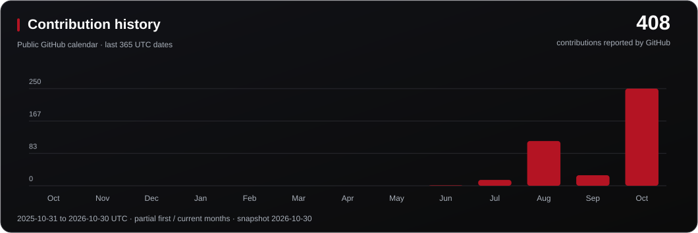
</picture>

<p align="center">
  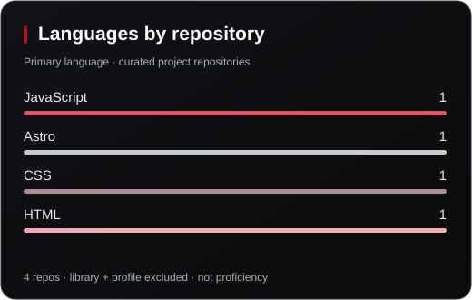
  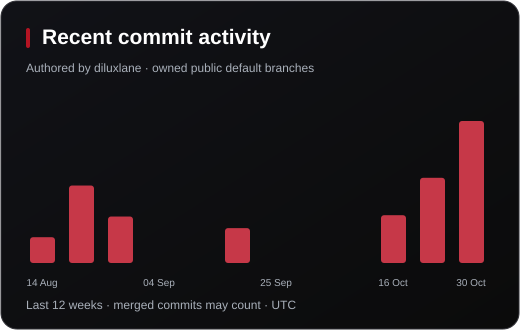
</p>

<p align="center">
  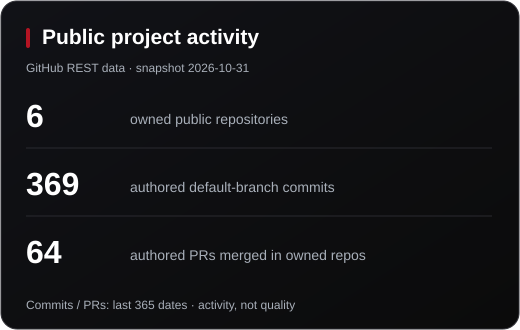
  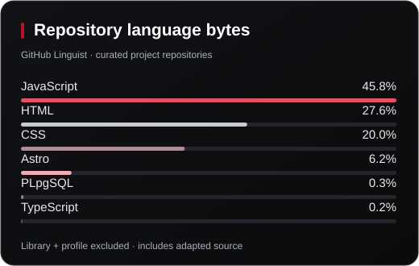
</p>

Language charts exclude **Zyberlane-Design-Library** and this profile repository. Other portfolios include attributed adaptations, so even the filtered bytes describe repository content, never mastery. Activity counts include reference-library work and may include merges or imported history.

[View the timestamped data](assets/analytics/snapshot.json) · [Native contributions](https://github.com/diluxlane?tab=overview) · [Update workflow](.github/workflows/profile-analytics.yml)

## Connect

<p align="center">
  <a href="https://github.com/diluxlane">GitHub</a> &nbsp; / &nbsp;
  <a href="https://zyberlane.com">Zyberlane</a> &nbsp; / &nbsp;
  <a href="https://www.instagram.com/dilux.ln/">Instagram · @dilux.ln</a>
</p>

---

<p align="center"><sub>Build with curiosity. Review with care. Credit the source.</sub></p>
